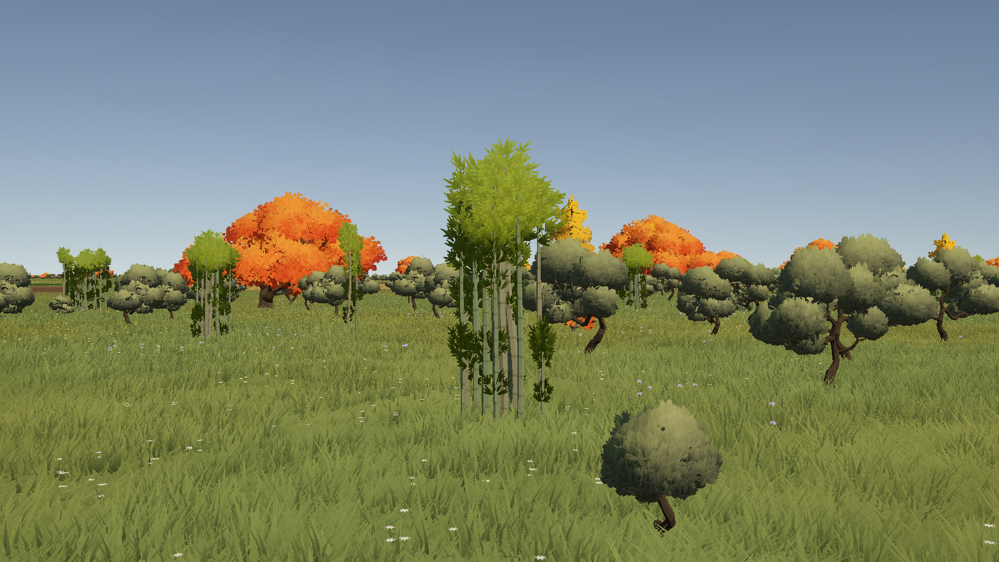

# Бамбук в смешанных рощах

В `MainScene` и будущую генерацию карт добавлены три варианта из Samurai Empire: `SM_Env_Bamboo_01`, `03`, `04`. Это отдельные стебли и кусты разной плотности высотой примерно 6–7 м в исходном масштабе.

Бамбук занимает около 18% существующих посадок. Он не выбирается основным видом рощи. Каждая связная группа сохраняет хотя бы одно обычное дерево; отдельные бамбуковые зоны не создаются. Позиции, повороты, масштабы и общее число посадок сохранены. Генератор сначала строит прежнюю схему рощ, затем отдельным детерминированным выбором меняет часть видов на бамбук. Вода, дороги, поля, скалы и остальные ограничения размещения сохраняются.

| Уровень | Бамбуковых посадок | Всего посадок |
|---|---:|---:|
| Основной Terrain | 1 466 | 8 084 |
| Окружение | 8 273 | 45 657 |
| Горизонт | 19 615 | 109 484 |
| Всего | 29 354 | 163 225 |

Одна бамбуковая посадка может содержать несколько стеблей. Плотность и размеры рощ не увеличивались.

[Вид сверху](Bamboo/MixedGrove.png).

## LOD и материалы

Бамбук использует общую инстансную отрисовку, плавные переходы и переосвещаемые 80-ракурсные импосторы с исправленной ориентацией. Тонкие стебли упрощаются щадяще; все листовые группы сохраняются. У двух густых вариантов средний и дальний бюджеты достигают одного доступного native-уровня упрощения — дополнительное удаление листвы ухудшало силуэт.

| Вариант | Основной, треугольники | Средний | Дальний |
|---|---:|---:|---:|
| Bamboo_01 | 528 | 352 | 224 |
| Bamboo_03 | 2 532 | 1 472 | 1 472 |
| Bamboo_04 | 4 100 | 2 448 | 2 448 |

Пороги существующей системы LOD сохранены. Исходные ассеты Synty не изменены.

## Проверки

- Генерация: детерминизм, async, cancellation, расстояния, вода, склоны, блокировщики и полная генерация исходной карты — PASS. Дополнительно проверены наличие бамбука, отсутствие чисто бамбуковых групп и точное совпадение позиций/поворотов/масштабов с вариантом без бамбука.
- Все 9 видов: 12 экранных размеров, mesh/impostor-переходы, fallback, повторное включение и cache — PASS.
- Бамбуковые mesh LOD: сравнение с основным мешем с 24 ракурсов — PASS. Средний IoU 0.981–0.984; дальний 0.932–0.983. Минимальный IoU импосторов при разных поворотах и цветах солнца — 0.817–0.842. Это метрики заданных проверочных ракурсов, не универсальная оценка качества.
- Настоящий Game View: четыре ракурса смешанной рощи, по 240 отрисованных кадров на состояние; затем 240 кадров движения камеры через переходы в обе стороны — PASS. Измерение выполнено в редакторе, не является GPU-профилем или обещанием FPS Player.
- Windows x64 Development Player: Succeeded, 0 ошибок, 25 предупреждений, 25.9 с. [Отчёт сборки](Bamboo/Build.txt). Контрольная сборка обновлена в `Builds/TreeOptimized/Map.exe`. Сцена сохранена; редактор оставлен вне Play Mode.

Отчёты: [сохранённые посадки](Bamboo/Placement.txt), [генерация](Bamboo/GenerationChecks.txt), [LOD](Bamboo/LodChecks.txt), [силуэты и цвет](Bamboo/VisualQuality.txt), [геометрия](Bamboo/GeneratedLods.txt), [Game View](Bamboo/GameView.txt). [Сравнение всех видов](Bamboo/LodContactSheet.png): бамбук находится в трёх нижних строках.

## Настройки

На `MapGenerator > Tree Placement Generator` добавлены `Bamboo Prefabs` и `Bamboo Fraction` (0.18). Ноль отключает примесь в будущей генерации. Обычный список деревьев остаётся отдельным, поэтому бамбук не становится доминирующим видом.

`Tools > Tactical Maps > Add Bamboo To Existing Groves` подключает библиотеку и смешивает бамбук с сохранёнными посадками без повторного анализа местности. Повторный запуск сохраняет уже смешанные посадки. Для изменения доли в существующей карте требуется обычная новая генерация с выбранной настройкой.

`Verify Bamboo In Game View` запускает проверку рощи с бамбуком; исходный режим проверки деревьев остаётся доступен отдельно.
