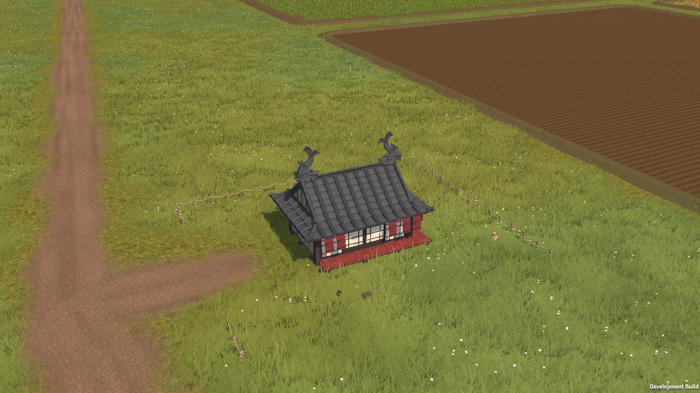

# Тени растительности: изменения и проверки

## Выбранный вариант

Быстрый профиль возвращает тени построек, предметов и ландшафта. Деревья их не отбрасывают; трава получает тени через одну аппаратную выборку с фильтрацией. Итоговый Performance: 200 м, один каскад, атлас 2048, жёсткие тени, Cascade Border 0.2, сила тени солнца 0.85. Balanced сохраняет 200 м и 2048, но использует два каскада и Soft Low. Terrain отбрасывает односторонние тени. Плотность травы, цветов и деревьев, геометрические LOD и дальность их отображения не уменьшались.

Меню `Tools > Tactical Maps > Shadows`:

- `Performance (object shadows)` — быстрый профиль.
- `Balanced (soft object shadows)` — мягкие тени с дополнительной стоимостью.
- `Maximum performance (off)` — полное отключение теней с сохранением остальных настроек качества.
- `Include tree shadows` — отдельный вариант с тенями деревьев, требующий дополнительного бюджета.
- `Reference (4 cascades, 50 metres)` — исходные параметры для сравнения.

Профили изменяют и текущую карту, и её builders. После применения через меню следует сохранить сцену. В `GrassSystem > Shadow Filtering` доступны Off / Hard / Soft; это получение теней, а не их отбрасывание. Для деревьев появился независимый Cast Shadows.

## Что установлено

Трава сама не отбрасывает тени: оба пути её рендера используют ShadowCastingMode.Off. Однако её фрагменты читали shadow map. Отключение общей галочки в URP убирало сразу построение карты теней и её чтение травой, Terrain, деревьями и другими материалами.

Изначально все три Terrain использовали TwoSided. Оптимизированные деревья уже имели отдельный постоянный shadow LOD2: смена видимого LOD не означала автоматической смены геометрии тени. Поэтому объяснять все скачки только переключением shadow LOD было бы неверно. Дальние импосторы освещены статически; сильные динамические тени на ближних кронах увеличивают заметность отличий.

В штатной URP-функции фильтрация shadow map выполняется до проверки выхода за её границы. Шейдеры травы и деревьев дополнительно использовали перегрузку GetMainLight без затухания по дистанции. Исправление добавляет fade и ранний выход. Для Terrain сохранены смешивание с baked shadows, GI, cookies и AO; файлы URP package не изменены.

В поддерживаемом режиме D3D12 MultiThreaded получены следующие GPU-медианы, мс, Game View 2219×1248, по 180 измерениям после 60 кадров прогрева:

| Проход / ракурс | Исходная выборка, 4 каскада / 50 м | Ранний выход и fade, Soft receiving |
|---|---:|---:|
| Grass.LitNormals, близко | 1.907 | 1.849 |
| Grass.LitNormals, кроны | 2.522 | 2.312 |
| DrawOpaqueObjects, кроны | 3.497 | 3.275 |

В ближнем ракурсе отключение получения теней травой снижало Grass.LitNormals примерно на 0.25 мс. Отключение отбрасывания теней деревьями снижало MainLightShadow примерно с 0.114 до 0.038 мс; у крон — с 0.091 до 0.022 мс. Эти результаты показывают, что расход нельзя устранить одним отключением кастинга деревьев. У Terrain и получателей теней также есть измеримая стоимость. Это показатели отдельных проходов, не полное время GPU-кадра.

Источник: [первый GPU-прогон](ShadowOptimization/GameView-SoftReceivers-4C-50m.txt). Он выполнялся с `-force-gfx-mt`, до добавления отдельного Hard receiving для травы.

Итоговый Performance дополнительно проверен в поддерживаемом GPU-режиме при 2219×1248:

| Проход / ракурс | Off, мс | Performance, мс |
|---|---:|---:|
| Grass.LitNormals, близко | 1.628 | 1.662 |
| MainLightShadow, близко | не выполняется | 0.041 |
| Grass.LitNormals, кроны | 2.108 | 2.164 |
| MainLightShadow, кроны | не выполняется | 0.049 |
| DrawOpaqueObjects, кроны | 3.148 | 3.225 |

Это медианы отдельных проходов. Их сумма — только ориентир добавленных расходов, а не точное полное GPU Frame Time. [Контроль итогового Performance](ShadowOptimization/GameView-Performance-GPU.txt).

## Обычный Game View: промежуточный Balanced

Проверка на исходном D3D12 NativeGraphicsJobsSplitThreading выполнялась без профайлера, с нормальным рендером Camera, без Camera.Render и ReadPixels в измеряемых кадрах. Четыре положения камеры и проход через LOD-переходы завершились; трава и деревья действительно отрисовывались.

| Ракурс | Без теней, начало / повтор, мс | Быстрый профиль, мс |
|---|---:|---:|
| Близко | 7.634 / 7.114 | 8.291 |
| Кроны | 9.453 / 8.942 | 10.463 |
| Роща | 6.662 / 6.645 | 7.534 |
| Постройка | 4.725 / 4.910 | 5.271 |

Это время кадра **в редакторе**, включая его накладные расходы. Относительно среднего двух Off-проверок добавка Balanced в этой серии составляет около 9–14%. Эти цифры нельзя переводить в обещание игрового FPS. Прогон: [Native Game View, Balanced](ShadowOptimization/GameView-Native-2C-200m.txt).

## Видимый standalone: выбор итогового Performance

После разрешения пользователя запущена серия обычных видимых игровых окон. Камера рисовала непосредственно в backbuffer; отсутствие пропущенных кадров проверялось через endCameraRendering: по 180 отрисованных кадров на состояние, включая 90 кадров прогрева. Все пять конфигураций завершились с PASS и кодом выхода 0.

В D3D12 MultiThreaded при одинаковых камерах и отключённом кастинге деревьев:

| Ракурс | Среднее двух Off-медиан, мс | Performance: 1 / 200 м / 2048 / Hard, мс | Balanced: 2 / 200 м / 2048 / Soft Low, мс |
|---|---:|---:|---:|
| Близко | 3.544 | 3.640 | 3.832 |
| Роща | 3.349 | 3.401 | 3.487 |
| Далеко | 4.520 | 4.548 | 4.545 |
| Постройка | 2.131 | 2.239 | 2.358 |

Для Performance добавка к времени кадра составила примерно 0.03–0.11 мс (около 1–5%). p95: близко 3.728 мс, роща 3.503 мс, далеко 4.604 мс, постройка 2.308 мс. Это общее время кадра development player, не изолированное время GPU. Для строгого игрового FPS следует измерять обычную целевую сборку без диагностик.

Уменьшение атласа до 1024 дало небольшую дополнительную экономию, но ухудшает детализацию; 2048 сохранён. Сокращение диапазона до 150 м мало меняет стоимость и сокращает полезную дистанцию. Итоговый выбор — 200 м / 2048, а мягкость и число каскадов разделены на Performance и Balanced.

Источники: [Performance](ShadowOptimization/Player-hard1-200-2048.txt), [Balanced](ShadowOptimization/Player-soft2-200-2048.txt), [150 м](ShadowOptimization/Player-soft2-150-2048.txt), [атлас 1024](ShadowOptimization/Player-soft2-200-1024.txt). [Отдельная серия Native Graphics Jobs](ShadowOptimization/Player-native-auto-ablation2-200.txt) проверяет отключение групп в исходном режиме; для варианта с двумя каскадами отключение деревьев само по себе также не убирает все расходы.

Финальный Performance отдельно перепроверен с исходным NativeGraphicsJobsSplitThreading, нормальной видимой камерой и 180 измерениями после 90 кадров прогрева. В каждом состоянии подтверждены все 270 отрисованных кадров:

| Ракурс | Off: начало / повтор, мс | Performance, мс |
|---|---:|---:|
| Близко | 4.621 / 4.309 | 4.464 |
| Роща | 3.919 / 3.913 | 4.038 |
| Далеко | 5.210 / 5.577 | 5.257 |
| Постройка | 2.710 / 2.731 | 2.892 |

В этой серии получено от практически неразличимой добавки до примерно 6% времени кадра. Отрицательную разницу в дальнем ракурсе считаем шумом измерения. [Финальный Native-прогон](ShadowOptimization/Player-Native-Performance.txt). Это подтверждает небольшой относительный расход, но не гарантирует 400–500 FPS при любом ракурсе и разрешении.

## Ограничения измерений

Падение с 400–500 до 100–200 FPS не воспроизвелось в таком размере на сохранённой карте в выбранных камерах. Поэтому причина именно этой величины просадки не объявляется установленной. Изменения устраняют подтверждённые расходы и дают отдельные переключатели для проверки на пользовательских ракурсах.

GPU Profiler Unity 6.3 не поддерживает Graphics Jobs. Ненулевые GPU-счётчики в таком режиме исключены из выводов; контрольный файл `GameView-HardReceivers-Native-4C-50m.txt` содержит неподдерживаемый прогон и не является источником GPU-оценок. [Ограничения GPU Profiler в Unity 6.3](https://docs.unity.com/en-us/engine/6000.3/manual/analysis/graphics-performance-profiling/profile-rendering/profiler-gpu).

При искусственных offscreen-проверках D3D12 происходили нативные сбои Unity; обычный Game View отдельно проверен без этого способа рендера. Смена графического API, обновление Editor или драйвера не выполнялись. Настройки Graphics Jobs в проекте не менялись.

## Повторение

`Verify in Game View` временно запускает Play Mode, отключает автоматическую генерацию карты и UI для сравнения, собирает продвигающиеся кадры и сохраняет изображения в `Logs/ShadowGameView`. После выхода восстанавливаются pipeline, Profiler, Game View и фоновые обновления. С Native Graphics Jobs инструмент собирает обычное время кадра; GPU-проходы — только в поддерживаемом режиме.

Development player поддерживает `-shadow-benchmark`, `-shadow-visible`, `-shadow-quality`, `-shadow-cascades`, `-shadow-distance`, `-shadow-atlas`, `-shadow-hard`, `-shadow-samples` и `-shadow-label`. Для обычного сравнения FPS окно должно быть видимым: скрытый Player может пропускать рендер, что обнаруживает проверка endCameraRendering. Дополнительный `-shadow-render-request` предназначен для специальных offscreen-проверок; его время нельзя считать игровым FPS. Измерения и кадры сохраняются в `Logs/ShadowBench/<label>`. Без аргумента `-shadow-benchmark` компонент не создаётся.

## Регрессии и сохранённая конфигурация

- `TreeLodChecks`: PASS — шесть видов, 11 экранных размеров, переходы mesh/impostor, overlap, fallback, кэш и восстановление ресурсов. [Отчёт](ShadowOptimization/LodChecks.txt).
- `MatteTerrainChecks`: PASS — угловая проверка матового освещения, дополнительные слои, стохастическая текстура и basemap. [Отчёт](ShadowOptimization/TerrainChecks.txt).
- Сборка development player: результат и предупреждения записаны в [Build.txt](ShadowOptimization/Build.txt). В полноценно перекомпилированном наборе оставались 25 прежних предупреждений FarmSurface/GrassFlowerStamps/RoadCommon; предупреждение нового shadow helper устранено. При сборке из кэша эти предупреждения повторно не выдаются.
- Итоговая сцена и PC URP asset сохранены; параметры, casting каждого Terrain, режим травы, флаги деревьев и состояние редактора перечислены в [FinalSettings.json](ShadowOptimization/FinalSettings.json).
